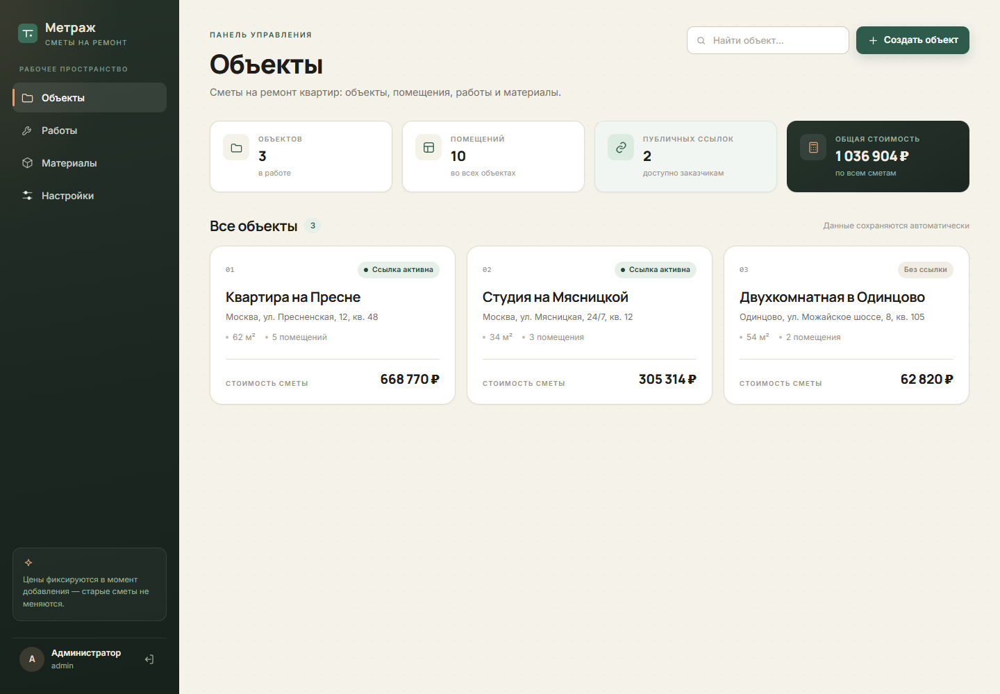
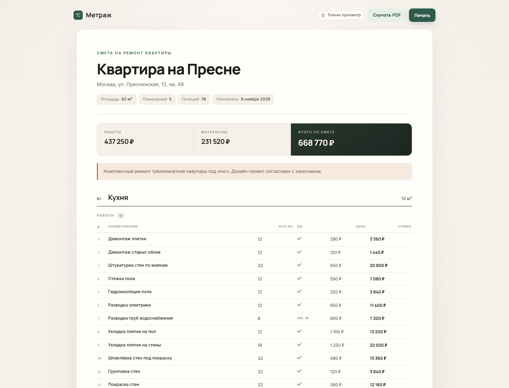

# Метраж — сметы на ремонт квартир

Готовое клиент-серверное веб-приложение для составления, хранения и показа заказчикам смет на ремонт квартир. Сделано по техническому заданию (версия 1.0 от 8 ноября 2026 г.).

Администратор ведёт объекты и помещения, собирает смету из справочников работ и материалов, получает автоматический расчёт и отправляет заказчику защищённую ссылку на чтение. Заказчик открывает смету без регистрации и не может ничего изменить.

- **Сайт:** `http://127.0.0.1:3000`
- **Демо-доступ:** `admin` / `Smeta2026!` (задаётся в `.env`, подсказка отключается через `DEMO_MODE=0`)
- **Валюта по умолчанию:** российский рубль, меняется в настройках



> После первого входа смените пароль в разделе «Настройки → Безопасность».

---

## Что уже работает

| Возможность | Реализация |
|---|---|
| Вход администратора | Логин и пароль, scrypt-хеши, серверные сессии в БД |
| Объекты | Создание, редактирование, удаление, площадь, адрес, описание |
| Помещения | Произвольное количество, название, площадь, описание |
| Справочник работ | Категории, единицы, базовые цены, активность, поиск |
| Справочник материалов | Единица закупки, размер упаковки, единица и норма расхода, цена |
| Конструктор сметы | Добавление строк из справочника, редактирование объёма и цены |
| Автоматический расчёт | Сумма строки, итоги помещения и объекта, округление упаковок вверх |
| Ручная корректировка | Режим «Вручную» и снятие автоподстановки количества |
| Фиксация цен | В строке сохраняется снимок параметров; справочник не меняет прошлые сметы |
| Публичная ссылка | Случайный токен 32 байта, только чтение, создание/перевыпуск/отзыв |
| Клиентская страница | Адаптивная, обновляется по той же ссылке после правок |
| PDF | Аккуратный документ A4 со всеми позициями и итогами |
| Мобильные устройства | Адаптивная вёрстка, таблицы превращаются в карточки |
| Журнал действий | Входы, изменения объектов, помещений, строк, справочников, ссылок |
| Резервные копии | Кнопка в настройках и `npm run backup`, инструкция по восстановлению |

---

## Быстрый старт

Требуется **Node.js 24+** (используется встроенный модуль `node:sqlite` без экспериментальных флагов). Проверено на Node.js 26.

```bash
npm install
npm start
```

Откройте `http://127.0.0.1:3000`. При первом запуске создаются база `data/metrazh.db`, администратор и демонстрационные данные: три объекта, 10 помещений, справочник из 31 работы и 21 материала.

Если база уже существует, демо-данные повторно не добавляются.

### Настройка

Скопируйте `.env.example` в `.env` и измените значения:

```env
PORT=3000
HOST=127.0.0.1
DATA_DIR=data
DB_FILE=metrazh.db
ADMIN_LOGIN=admin
ADMIN_PASSWORD=change-me-please
DEMO_MODE=0
SEED_DEMO=0
PUBLIC_BASE_URL=https://smeta.example.ru
```

| Переменная | Назначение |
|---|---|
| `PORT`, `HOST` | Адрес прослушивания. По умолчанию только локальный `127.0.0.1` |
| `DATA_DIR`, `DB_FILE` | Каталог и имя файла SQLite |
| `ADMIN_LOGIN`, `ADMIN_PASSWORD` | Первый администратор. Применяются **только к пустой базе** |
| `DEMO_MODE` | Показывать подсказку с демо-доступом на странице входа |
| `SEED_DEMO` | Заполнять ли пустую базу справочниками и демо-объектами |
| `PUBLIC_BASE_URL` | Внешний адрес сайта для формирования ссылок (за прокси) |
| `TRUST_PROXY` | `1`, если приложение работает за Nginx/Caddy |
| `COOKIE_SECURE` | `1` для HTTPS-only cookie (в production включён по умолчанию) |
| `SESSION_TTL_DAYS` | Срок жизни сессии, по умолчанию 7 дней |
| `LOGIN_RATE_LIMIT` | Попыток входа на IP+логин за окно |
| `APP_NAME` | Название приложения по умолчанию |

Если поменять `ADMIN_PASSWORD` после создания базы, пароль не изменится — используйте «Настройки → Безопасность».

---

## Как пользоваться

1. **Объект.** «Объекты → Создать объект»: название, адрес, площадь, описание.
2. **Помещения.** Внутри объекта — «Добавить помещение», укажите название и площадь.
3. **Работы.** Откройте помещение, нажмите «Добавить работу», найдите позицию в справочнике. Цена и единица подставятся из справочника.
4. **Материалы.** «Добавить материал». Если в справочнике заданы норма расхода и размер упаковки, количество посчитается автоматически: `площадь × норма ÷ упаковка`, округление вверх. Количество можно скорректировать вручную.
5. **Итоги.** Пересчитываются сразу после изменения объёма или цены, состояние сохранения видно в карточке итогов.
6. **Ссылка.** На странице объекта создайте клиентскую ссылку, скопируйте и отправьте заказчику. Кнопки «Обновить ссылку» и «Отозвать» управляют доступом.
7. **PDF.** Кнопка «PDF» на объекте или «Скачать PDF» в помещении.

### Клиентская страница



### Демо-данные

- «Квартира на Пресне» — 62 м², 5 помещений, 76 позиций, публичная ссылка включена.
- «Студия на Мясницкой» — 34 м², 3 помещения, публичная ссылка включена.
- «Двухкомнатная в Одинцово» — 54 м², 2 помещения, смета в работе, ссылка отключена.

---

## Технологии и архитектура

- **Сервер:** Node.js, Express 5, встроенный `node:sqlite` (SQLite в режиме WAL).
- **Клиент:** нативные ES-модули, без сборщика; общие модули расчётов используются и на сервере, и в браузере.
- **PDF:** PDFKit + шрифт PT Sans (OFL), полная кириллица.
- **Шрифты интерфейса:** Manrope и Inter (OFL), лежат локально в `public/fonts`.
- **Деньги:** целые копейки в БД и API. Никаких `float` для денежных значений.
- **Количества:** десятичные строки в БД, точная арифметика на `BigInt` с масштабом 10⁻⁶.
- **Сессии:** случайный токен в HttpOnly/SameSite=Lax cookie, в БД хранится SHA-256 токена.
- **CSRF:** токен сессии в заголовке `X-CSRF-Token` + проверка Origin.
- **CSP:** только собственные скрипты, стили и шрифты.

### Структура

```
server/
  index.js            запуск, сессии, graceful shutdown
  app.js              маршруты, статика, публичные страницы
  lib/
    config.js         конфигурация из .env
    db.js             подключение, миграции, аудит
    seed.js           первый администратор и демо-данные
    auth.js           scrypt, сессии, CSRF, rate limit
    data.js           выборки и сериализация
    pdf.js            генерация PDF
    publicPage.js     серверный HTML клиентской сметы
    validate.js       валидация полей
  routes/             auth, projects, rooms, lines, catalog, settings
shared/
  money.js            точная десятичная арифметика и форматирование
  calc.js             расчёты строк и итогов
  units.js            короткие обозначения единиц
public/
  app.html            административная SPA
  assets/app.js       интерфейс администратора
  assets/app.css      стили панели
  assets/site.css     стили клиентской страницы
  fonts/              локальные шрифты
scripts/
  backup.mjs          резервная копия
  restore.mjs         восстановление
tests/                unit- и API-тесты
docs/BACKUP.md        процедура резервного копирования
```

### Схема данных

`users`, `sessions`, `projects`, `rooms`, `work_catalog`, `material_catalog`, `estimate_lines`, `app_settings`, `audit_log`.

Ключевые решения:

- `estimate_lines` хранит **снимок** названия, категории, единицы, цены, упаковки, нормы и площади расчёта. Поэтому изменение справочника не влияет на старые сметы.
- Публичный токен хранится в `projects.public_token`; отзыв обнуляет токен и флаг доступа.
- Все дочерние записи удаляются каскадно вместе с объектом/помещением.
- Денежные поля — `INTEGER` в копейках; количества — десятичный текст.

---

## Безопасность

- Пароли хранятся только как scrypt-хеши с индивидуальной солью.
- Сессионный токен — 32 случайных байта; в БД только SHA-256.
- Куки `HttpOnly`, `SameSite=Lax`, `Secure` при HTTPS.
- Все административные API защищены серверной проверкой сессии; скрытие кнопок в интерфейсе не является защитой.
- Изменяющие запросы требуют CSRF-токен; дополнительно проверяется `Origin`.
- Ограничение попыток входа по IP+логину.
- Публичная ссылка — 32 случайных байта, только чтение, отзывается.
- Экранирование пользовательских данных в HTML, CSP, `X-Frame-Options: DENY`, `nosniff`, `Referrer-Policy`.
- Журнал действий администратора хранится в `audit_log`.

**Обязательно для production:**

1. HTTPS (reverse proxy).
2. `NODE_ENV=production`, `COOKIE_SECURE=1`, `TRUST_PROXY=1`.
3. Новый пароль администратора.
4. `DEMO_MODE=0`, `SEED_DEMO=0` при чистой базе.
5. Регулярные резервные копии и ограниченный доступ к `data/`.

---

## PDF

PDF формируется на сервере по запросу:

- администратор: `/api/projects/:id/pdf` (только после входа);
- заказчик: `/p/:token/pdf` (только при активной ссылке).

Документ A4 содержит: название и адрес объекта, площадь, дату, помещения, работы и материалы с количеством, единицами, ценами и суммами, итоги по помещениям, итоги по работам/материалам и общий итог. Таблицы переносятся между страницами с повтором шапки и названия помещения.

Пример готового документа: [docs/sample-smeta.pdf](docs/sample-smeta.pdf).

---

## Резервное копирование и восстановление

Кратко:

```bash
npm run backup                 # data/backups/metrazh-<дата>.db
npm run restore -- data/backups/metrazh-<дата>.db
```

В интерфейсе: «Настройки → Данные → Скачать резервную копию».

Перед восстановлением **остановите сервер**. Подробная процедура, расписание и проверка восстановления — в [docs/BACKUP.md](docs/BACKUP.md).

---

## Тесты

```bash
npm test
```

12 тестов: точная денежная арифметика, округление упаковок, ручной/автоматический режимы, полный API-сценарий, фиксация цен, публичная ссылка и её отзыв, валидация, защита от запросов без CSRF, смена пароля.

Дополнительно в `scripts/` лежат служебные сценарии проверки интерфейса через установленный Microsoft Edge (`qa-shots.mjs`, `qa-flow.mjs`) и просмотра PDF (`pdf-preview.mjs`). Они не нужны для работы сайта.

---

## Развёртывание

Приложение не требует сборки: достаточно Node.js и каталога с исходниками.

### За обратным прокси

```nginx
server {
    listen 443 ssl http2;
    server_name smeta.example.ru;

    ssl_certificate     /etc/letsencrypt/live/smeta.example.ru/fullchain.pem;
    ssl_certificate_key /etc/letsencrypt/live/smeta.example.ru/privkey.pem;

    client_max_body_size 4m;

    location / {
        proxy_pass         http://127.0.0.1:3000;
        proxy_set_header   Host              $host;
        proxy_set_header   X-Real-IP         $remote_addr;
        proxy_set_header   X-Forwarded-For   $proxy_add_x_forwarded_for;
        proxy_set_header   X-Forwarded-Proto $scheme;
    }
}
```

В `.env`:

```env
NODE_ENV=production
HOST=127.0.0.1
PORT=3000
TRUST_PROXY=1
COOKIE_SECURE=1
PUBLIC_BASE_URL=https://smeta.example.ru
DEMO_MODE=0
SEED_DEMO=0
```

### systemd (Linux)

```ini
[Unit]
Description=Metrazh estimates
After=network.target

[Service]
Type=simple
User=metrazh
WorkingDirectory=/opt/metrazh
ExecStart=/usr/bin/node server/index.js
Restart=on-failure
Environment=NODE_ENV=production

[Install]
WantedBy=multi-user.target
```

### Windows

Запуск через `npm start` в отдельном окне или службу-обёртку (NSSM, Task Scheduler). Каталог `data/` должен быть доступен на запись только учётной записи приложения.

### Регулярные копии

Linux (cron, ежедневно в 02:30):

```cron
30 2 * * * cd /opt/metrazh && /usr/bin/node scripts/backup.mjs >> /var/log/metrazh-backup.log 2>&1
```

Windows (Планировщик заданий): действие `node scripts\backup.mjs`, рабочая папка `C:\Game\Smeta`.

---

## Принятые допущения и открытые вопросы

ТЗ оставляло часть вопросов на согласование. В MVP принято следующее:

- Название продукта — **«Метраж»**, меняется в настройках вместе с подзаголовком и контактами.
- Валюта по умолчанию — **₽**, переключается в настройках (RUB, KZT, BYN, USD, EUR, UAH, GEL, AMD, UZS).
- Налоги, скидки и наценки не добавлялись — их не было в обязательном объёме MVP.
- Материалы видны заказчику; скрытие не реализовано (не требуется для MVP).
- PDF включён в объём MVP.
- Один администратор; многоролевой доступ, история версий и электронное согласование не входят в MVP.
- Язык интерфейса — русский.
- Публичная ссылка показывает дату последнего обновления сметы.

Если понадобятся налоги/скидки, несколько сотрудников, скрытие материалов, версии смет или фирменный домен — архитектура допускает расширение без переписывания базы.

---

## Соответствие критериям приёмки

| Критерий из ТЗ | Где проверить |
|---|---|
| Безопасный вход администратора | `/login` |
| Объект и несколько помещений | «Объекты» → объект → помещения |
| Несколько работ и материалов в помещении | Страница помещения |
| Выбор из справочника подставляет название, единицу и цену | «Добавить работу/материал» |
| Пересчёт суммы и итогов | Изменение объёма/цены в строке |
| Материал вручную или по норме, округление вверх, корректировка | «Расчёт» в строке материала |
| Справочник не меняет прошлые сметы | Изменить цену в справочнике → смета не изменилась |
| Уникальная публичная ссылка | Страница объекта → «Создать ссылку» |
| Доступ только для чтения без авторизации | Открыть ссылку в приватном окне |
| Заказчик не получает административный доступ | API отвечает 401 без сессии |
| Отзыв ссылки | «Отозвать»; старая ссылка → 404 |
| Правки видны по прежней ссылке | Изменить смету → обновить клиентскую страницу |
| Мобильная и десктопная вёрстка | Ширина 390 px и 1440 px |
| PDF со строками и итогами | «Скачать PDF» |

---

## Передача проекта

Вместе с исходным кодом передаются:

- `.env.example` — шаблон настроек;
- `README.md` — запуск, архитектура, эксплуатация;
- `docs/BACKUP.md` — резервное копирование и восстановление;
- `tests/` — автоматические проверки;
- `data/metrazh.db` — рабочая база с демо-данными (при передаче можно очистить: удалить файл и запустить заново).

Перед публикацией смените пароль администратора и выключите демо-режим.
